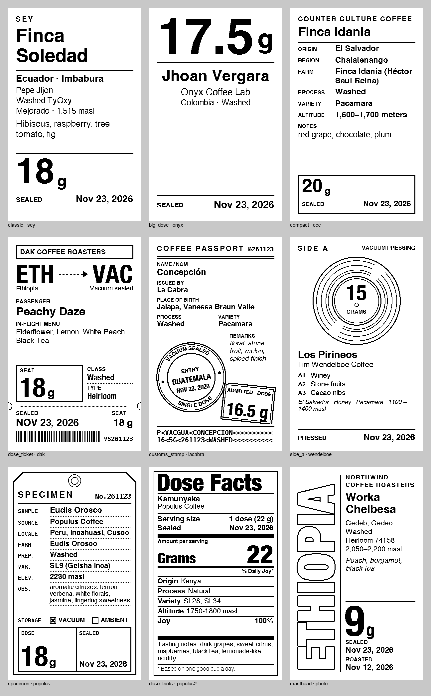

# Bean dose labels

A small web app that runs on your Mac and prints labels for vacuum-sealed coffee doses on a Phomemo thermal label printer. Paste a roaster's product URL or a photo of the bag, enter the dose, pick a design, print.



## What you need

- A Mac (macOS 13 or newer recommended).
- Python 3.11 or newer. Check with `python3 --version`; if missing: `brew install python@3.12`.
- A Phomemo **M220 or M221** with **50 × 80 mm** die-cut labels. Other Phomemo models are not supported yet (different head widths).
- Optional, for auto-fill from a URL or photo: [Claude Code](https://claude.com/claude-code) installed and signed in (`claude` in your terminal). Without it the app still works; you type the details in.

## Install

1. Get the code (the repo is private, so use an account with access):
   ```
   gh repo clone pudubrews-ai/labelprinter
   cd labelprinter
   ```
   or `git clone https://github.com/pudubrews-ai/labelprinter.git`.
2. Turn the printer on.
3. Start the app:
   ```
   ./run.sh
   ```
   The first run creates a private Python environment in `.venv` and installs the dependencies (about a minute). Then it opens **http://127.0.0.1:8221** in your browser.
4. Allow Bluetooth. macOS asks the first time the app scans for printers. If it does not ask, or you said no, open **System Settings → Privacy & Security → Bluetooth**, turn on the terminal app you ran `./run.sh` from (Terminal, iTerm, Warp…), quit and reopen that terminal, and run `./run.sh` again.
5. In the app, open the **Printer** dropdown and press **Scan**. With one printer nearby it is picked automatically and remembered.

Pairing the printer in the macOS Bluetooth menu should not be needed (not yet tested on a fresh Mac). If the status stays blank after selecting it, pair it there and retry.

## Use

1. Paste a roaster product URL and press **Extract**, or choose a photo of the bag. Auto-fill takes a few seconds. Check the fields and fix anything wrong.
2. Enter the **dose** in grams and the number of **copies** (one per bag). The sealed date is today unless you change it.
3. Pick a design. The preview is exactly what the printer gets.
4. Press **Print**.

Your fields are kept if you refresh the page; **Clear** empties them.

## Stop, update, uninstall

- Stop: press `Ctrl+C` in the terminal running it.
- Update: `git pull`, then `./run.sh` (it reinstalls dependencies when they change).
- Uninstall: delete the folder, and `~/Library/Application Support/BeanLabels` (remembered printer).

## Troubleshooting

| Problem | Fix |
|---|---|
| Scan finds nothing | Printer on and nearby? Bluetooth allowed for your terminal app (Install step 4)? Close the Phomemo phone app, which can hold the connection. |
| Status shows not responding | The printer may have gone to sleep. Press its button, then refresh the page. |
| "Auto-fill unavailable" | Install Claude Code and run `claude` once to sign in, then restart the app. |
| Print comes out offset or cropped | The app is built for the M220/M221 with 50 × 80 mm labels only. |
| `Already running on port 8221` | It is already running; the browser opens to it. |

## Technical notes

## How it works
1. Paste a roaster URL (page is fetched by the backend, reduced to text/meta/JSON-LD, then passed to `claude -p`) or drop/take a photo of the bag (`claude -p` with only the `Read` tool on a downscaled copy). Page and image text are treated as untrusted data. Results fill editable fields; manual entry always works.
2. Enter dose and copies, pick a design; the preview is the real 1-bit 400x640 PNG rendered server-side.
3. Print sends N copies over one BLE connection, checking paper before each one.

Layout: `labelapp/printer.py` (BLE, CLI: `python -m labelapp.printer status`), `extract.py` (claude CLI), `designs/` (labels), `server.py` (FastAPI), `static/` (UI), `config.py` (port, model, BLE patterns), `capabilities.py` (is Claude available: `claude auth status`, no model call). Samples: `python -m labelapp.samples` writes `docs/samples/`. `prototype/` holds the original probe scripts.

## Printer facts
Printers are found by BLE scan (UI: Printer picker + Scan; API: `GET /api/printers`, `POST /api/printer/select {id}`). Candidates advertise service af30/ff00 or a name starting M0/M1/M2/Q/D/T0/P12 or containing "Phomemo"; on connect the device must expose service ff00 with ff02/ff03 or it is rejected as not a compatible Phomemo. The selection is kept in the browser (localStorage) and in `~/Library/Application Support/BeanLabels/printer.json` (override dir with `LABELAPP_STATE_DIR`). Protocol and geometry are the M220/M221 ones (576 px head, 50x80 mm labels); other models may need per-model settings later. Service ff00, write ff02 (no response), notify ff03. Head 576 px / 203 dpi; label 400x640 px centred (88 px blank each side). Job: `1b40; 1b37 07 78 02; 1d7c 05; 1d7630 00 48 00 80 02 + raster; 1b4a 20`. Status: `1f1108` battery, `1f1111` paper (89 = present), `1f1113` head temp.

## Adding a design
Drop a file in `labelapp/designs/` (e.g. `mine.py`); it appears in the picker automatically.
```python
from .common import *        # font, fit_block, wrap, ellipsize, draw_lines, val, join, fmt_dose, new_canvas, finish...
NAME = "My design"           # shown in the UI
ORDER = 4                    # optional sort position

def render(data):            # data: dict of the form fields (+ dose, seal_date)
    im, d = new_canvas()     # 1-bit 400x640, fontmode "1" (no anti-aliasing)
    d.text((24, 24), val(data, "coffee_name"), font=font(40), fill=0)
    return finish(im)        # asserts mode "1" and 400x640
```
Use `val(data, key)` so empty fields are omitted, and keep ~24 px margins. Run `python -m labelapp.samples` to preview.
